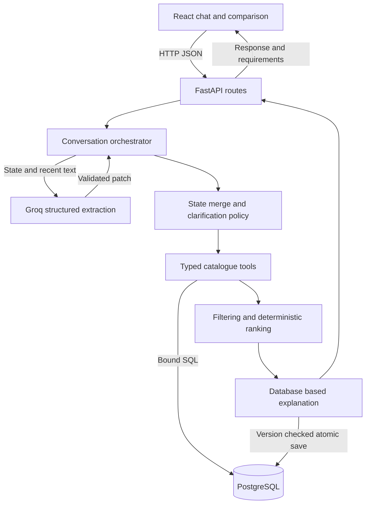
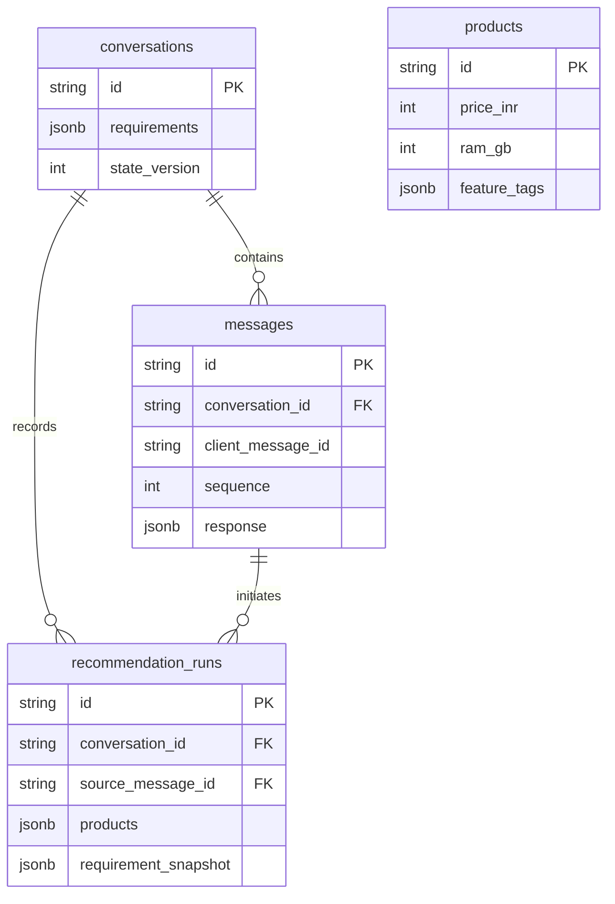

# Architecture

## One turn

1. Validate input and inspect the completed-request UUID. Replays return persisted output.
2. Snapshot conversation version, requirements, recent messages, and previous recommendations; close the session.
3. Interpret the message using Groq (or explicitly configured demo parser).
4. Validate changes and evidence, merge KEEP/SET/CLEAR, and determine whether clarification is needed.
5. If ready, filter the database, apply required feature membership, rank eligible products, and construct factual cards.
6. If no match, diagnose whether a budget-only change could satisfy all remaining constraints. Store a proposal; do not apply it yet.
7. Compare-and-swap state version and commit user message, assistant response, state, and run evidence atomically.
8. UI reloads authoritative conversation state and displays the latest result.

## Database relationships

Run products are factual JSON snapshots with original catalogue IDs, rather than product foreign keys, so the demonstration retains what was shown if seed records are later updated. Current product lookup uses the catalogue table. Message rows are uniquely ordered per conversation; request UUIDs are unique per conversation. Every accepted turn increments version once and creates two ordered messages.

The hosted model cannot access PostgreSQL credentials. It returns data, not SQL. Free API failure remains an explicit error. No production authentication or public hosting is provided.
